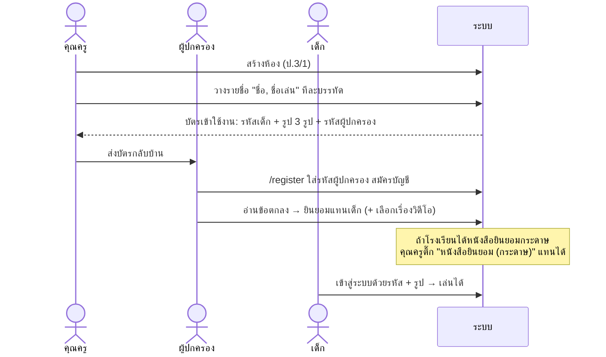
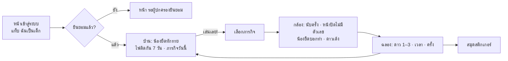
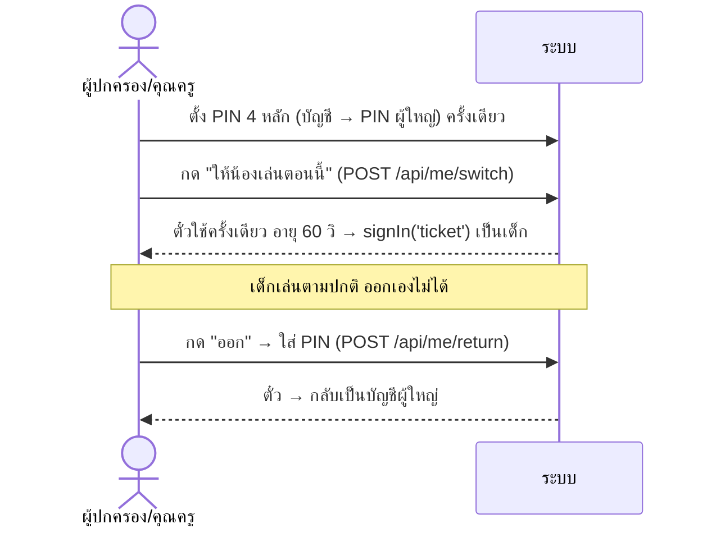
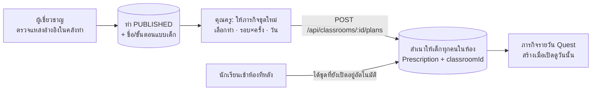

# 🧭 AI Physio Kids — Flow งานและฟังก์ชัน

> แนวทางใหม่: แอปใช้ **ดูแลและป้องกัน** (ไม่ใช่รักษา) สำหรับ **เด็กประถม 7–12 ปี**
> แกนหลักที่คงไว้: **กล้อง AI** จับท่า → คำนวณมุม → นับครั้ง → ตรวจท่าชดเชย → โค้ชพูดบอก
> อย่างอื่นรอบ ๆ ปรับใหม่หมด: บทบาท การเข้าสู่ระบบ หน้าจอ คำพูด ข้อมูลตัวอย่าง มาสคอต
>
> เอกสารคู่กัน: [KIDS-ART-UI.md](KIDS-ART-UI.md) (art/UI) · [../CODEBASE.md](../CODEBASE.md) (โค้ด) · [qa/REPORT.md](qa/REPORT.md) (ผลตรวจ)

---

## 1. ใครทำอะไร

| บทบาท | ใน DB | เข้าสู่ระบบด้วย | งานหลัก |
|-------|-------|---------------|---------|
| **เด็ก** | `PATIENT` | รหัสเด็ก 6 ตัว + แตะรูปสัตว์ 3 รูปตามลำดับ · หรือผู้ใหญ่กด "ให้น้องเล่น" | ดูภารกิจวันนี้ → เล่นกับกล้อง → ได้ดาว/สติกเกอร์ |
| **คุณครู** | `TEACHER` | อีเมล + รหัสผ่าน | สร้างห้อง เพิ่มนักเรียน พิมพ์บัตร **ให้ภารกิจ (คนเดียวที่ให้ได้)** ดูความก้าวหน้า เล่นในห้อง |
| **ผู้ปกครอง** | `PARENT` | อีเมล + รหัสผ่าน (สมัครด้วยรหัสผู้ปกครองจากบัตร) | **ยินยอมแทนเด็ก** (ข้อตกลง + วิดีโอ) ดูความก้าวหน้า ให้น้องเล่นที่บ้าน |
| **ผู้เชี่ยวชาญ** (นักกายภาพ/อาจารย์) | `CLINICIAN` | อีเมล + รหัสผ่าน | ดูแลคลังท่า ตรวจรอบที่ระบบแจ้งเตือน รายงาน/replay/AI วิเคราะห์ แนะนำคุณครู |

ผู้ใหญ่ทุกคนมี "โปรไฟล์ผู้ใหญ่" (ตาราง `clinicians`) และเห็นเด็กผ่าน `CareAssignment` เท่านั้น:
คุณครู = `TEACHER` (ได้ตอนเด็กเข้าห้อง) · ผู้ปกครอง = `GUARDIAN` (ได้ตอนใส่รหัสผู้ปกครอง) · ผู้เชี่ยวชาญ = `PRIMARY/SUPPORTING`

---

## 2. Flow หลัก

### 2.1 เริ่มต้นใช้งาน (โรงเรียน → บ้าน)

### 2.2 เด็กเล่นทุกวัน

### 2.3 ผู้ใหญ่ให้เด็กเล่นบนเครื่องตัวเอง ("ให้น้องเล่น" / "เล่นในห้อง")

ห้องเรียน: คุณครูเปิดแท็บ **เล่นในห้อง** → เห็นตารางหน้านักเรียน → แตะชื่อ → เด็กเล่น → "ออก" + PIN ครู → กลับมาตาราง

### 2.4 ให้ภารกิจ (คุณครูเท่านั้น)

ท่าที่เป็น DRAFT (แหล่งอ้างอิงยังไม่ยืนยัน) ไม่ขึ้นเป็นภารกิจ จนกว่าผู้เชี่ยวชาญจะตรวจ

### 2.5 ติดตามผล

| ใคร | เห็นอะไร |
|-----|---------|
| เด็ก | ดาว ไฟติดกัน สติกเกอร์ (**ไม่มี % ไม่มีกราฟ ไม่มีองศา**) |
| ผู้ปกครอง | ลูกแต่ละคน: วันนี้ครบไหม ไฟติดกัน ดาว 7 วัน · กราฟ 14 วัน · รอบล่าสุด (ดาว + %) |
| คุณครู | ทั้งห้อง: ใครครบวันนี้ · ใคร "ควรดูท่า" (ความถูกต้อง 7 วัน < 60%) · ใครรอความยินยอม |
| ผู้เชี่ยวชาญ | ภาพรวม · คิวรอตรวจ · แนวโน้ม/ประมาณการ · รายงาน + replay + วิดีโอ (ถ้ายินยอม) |

---

## 3. หน้าจอ ↔ ฟังก์ชัน ↔ API

### เด็ก (`src/components/kids/`)
| หน้าจอ | ฟังก์ชัน | API |
|--------|---------|-----|
| เข้าสู่ระบบ (`auth/kid-login.tsx`) | รหัส 6 ตัว → รูป 3 รูป, ผิด 5 ครั้งล็อก 10 นาที | next-auth `kid-code` |
| บ้าน (`kids-home.tsx`) | ทักทาย, ไฟ 7 วัน, ภารกิจวันนี้, เล่นเลย | `GET /api/stats`, `GET /api/quests/today` |
| ภารกิจ (`kids-missions.tsx`) | ท่าตัวอย่าง + 3 ขั้นตอน, เริ่ม/เลือกข้าง | `GET /api/exercises`, `GET /api/quests/today` |
| กล้อง (`physio/live-session-view.tsx`) | เลือกภารกิจ, เล่น, ฉลอง | `POST /api/sessions`, `…/logs`, `…/frames`, `…/video`, `POST /api/coach`, `/api/tts` |
| สติกเกอร์ (`kids-rewards.tsx`) | สมุดสติกเกอร์ + รอบล่าสุดเป็นดาว | `GET /api/stats`, `GET /api/sessions` |
| ออก (`exit-kid-mode.tsx`) | ออกเอง หรือใส่ PIN ผู้ใหญ่ | `POST /api/me/return` + `ticket` |

### คุณครู (`src/components/teacher/`)
| หน้าจอ | ฟังก์ชัน | API |
|--------|---------|-----|
| ห้องเรียน (`classes-view.tsx`) | รายการห้อง, ครบวันนี้กี่คน, สร้างห้อง | `GET/POST /api/classrooms` |
| ห้อง › วันนี้ | ตารางนักเรียน ✓/ไฟ/ดาว/ควรดูท่า | `GET /api/classrooms/:id` |
| ห้อง › ภารกิจ (`assign-form.tsx`) | ให้ชุดใหม่, ปิดชุด | `POST/PATCH /api/classrooms/:id/plans` |
| ห้อง › นักเรียน (`kid-cards.tsx`) | เพิ่มรายชื่อ, พิมพ์บัตร, รีเซ็ตรหัส/รูป, หนังสือยินยอมกระดาษ | `POST /api/classrooms/:id/students`, `POST /api/kids/:id/codes`, `POST /api/kids/:id/consent` |
| ห้อง › เล่นในห้อง | เลือกเด็ก → โหมดเด็ก | `POST /api/me/switch` |
| คลังท่า (`exercise-library.tsx`) | ดูท่าที่เด็กเห็น + ชื่อจริง | `GET /api/exercises` |
| บัญชี | ตั้ง PIN (ครูไม่มีแชท — แชทเป็นของผู้เชี่ยวชาญกับผู้ปกครอง) | `/api/me/pin` |

### ผู้ปกครอง (`src/components/parent/`)
| หน้าจอ | ฟังก์ชัน | API |
|--------|---------|-----|
| สมัคร (`auth/parent-register-form.tsx`) | รหัสผู้ปกครอง + อีเมล | `POST /api/parent/register` |
| ลูกของฉัน (`children-view.tsx`) | การ์ดลูก, เพิ่มลูกอีกคน | `GET /api/parent/children`, `POST /api/parent/link` |
| หน้าลูก (`child-consent.tsx`) | ยินยอม/ถอน, วิดีโอ, ให้น้องเล่น, ความก้าวหน้า | `POST /api/kids/:id/consent`, `POST /api/me/switch`, `/api/stats`, `/api/sessions` |
| ข้อความ (`adult/care-messages.tsx`) | คุยกับผู้เชี่ยวชาญเรื่องลูก เห็นว่าใครดูแล | `/api/messages*` |
| บัญชี | ตั้ง PIN | `/api/me/pin` |

### ผู้เชี่ยวชาญ (`src/components/expert/` + `physio/doctor-*`)
| หน้าจอ | ฟังก์ชัน | API |
|--------|---------|-----|
| ภาพรวม | สรุป, คิวรอตรวจ, แจ้งเตือน | `GET /api/clinician/summary`, `GET /api/sessions?awaitingReview=true` |
| เด็ก | ข้อมูล, แนวโน้ม, AI วิเคราะห์ | `/api/patients/:id`, `/api/patients/:id/ai-insights` |
| ห้องเรียน (อ่านอย่างเดียว) | ความก้าวหน้าแต่ละห้อง | `GET /api/classrooms*` |
| รายงาน | รายงาน, replay, วิดีโอ, ลงความเห็น | `/api/reports/:id`, `/api/sessions/:id/review` |
| ข้อความ (`adult/care-messages.tsx`) | คุยกับผู้ปกครองของเด็กแต่ละคน; หัวแชทบอกว่าเด็กคือใคร (ชื่อเล่น อายุ ห้อง ครู ความยินยอม) และผู้ปกครองคนไหนลงทะเบียน (ชื่อ อีเมล วันที่) | `GET /api/messages/threads`, `/api/messages` |

---

## 4. กติกาความปลอดภัยของข้อมูลเด็ก (บังคับในโค้ด)

- ผู้ใหญ่เห็นเด็กเฉพาะที่ผูกด้วย `CareAssignment` (`src/lib/access.ts`); นอกขอบเขต = 404
- เด็กเล่นได้เมื่อผู้ปกครองยินยอมข้อตกลงฉบับปัจจุบัน **หรือ** โรงเรียนบันทึกหนังสือยินยอมกระดาษ (`childHasConsent`)
- วิดีโอบันทึกได้เฉพาะเมื่อผู้ปกครองยินยอม; ถอนความยินยอมวิดีโอ **หรือถอนความยินยอมข้อตกลง** แล้วลบวิดีโอทั้งหมดทันที และ API ไม่ส่งวิดีโอให้ใครอีกเมื่อไม่มีความยินยอมแล้ว
- แชทมีแค่ผู้เชี่ยวชาญ ↔ ผู้ปกครอง (`CHAT` ใน `src/lib/roles.ts`); เด็กและครูไม่มีแชท; เด็กไม่มีผู้ช่วย AI แบบสนทนา; โค้ชในกล้องพูดสั้น ๆ ไม่มีตัวเลข ไม่ดุ
- รหัสรูปภาพเก็บแบบ hash (scrypt) แสดงตอนสร้าง/รีเซ็ตเท่านั้น; ตั๋วสลับบัญชีเซ็นด้วย `NEXTAUTH_SECRET` ใช้ได้ครั้งเดียว 60 วิ
- เฉพาะคุณครูสร้าง/แก้ชุดภารกิจ; ผู้เชี่ยวชาญบันทึกผลลัพธ์/สถานะได้ (API) แต่สร้างไม่ได้
